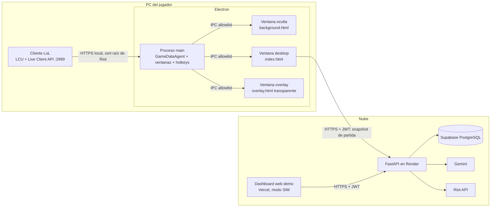

# Plan de migración: de Overwolf a Electron + backend en la nube

Proyecto académico LolAnalyzer. Este documento describe cómo dejar de depender de Overwolf para el overlay, desplegar la aplicación y cumplir las políticas de Riot Games, sin perder funciones que hoy operan.

**Fecha de entrega:** 17 de noviembre de 2026. **Inicio:** 28 de octubre de 2026.

### Decisiones confirmadas

| Tema | Decisión |
|---|---|
| Código de Overwolf | Se conserva, documentado como **ruta de distribución pública o comercial** (fuera del ámbito académico). No se usa en la entrega |
| Cliente LCU en Electron | **Implementación propia** en TypeScript, espejo de `riot_lcu.py` (sin `league-connect`) |
| Hosting | Render (backend) y Vercel (web demo), confirmado |
| Instalador | **Obligatorio.** Es probable que los evaluadores lo instalen en sus equipos (ver fase 7.3) |

---

## 0. Objetivos y reglas de la migración

### Objetivos
1. Overlay funcional sobre League of Legends sin aprobación de Overwolf ni de Riot, usando una ventana transparente de Electron.
2. Backend desplegado en la nube, multiusuario y seguro.
3. Cliente de escritorio instalable (`.exe`) que lee los datos locales del juego y los envía al backend.
4. Versión web de demostración (modo SIM) para evaluadores sin League instalado.
5. Cumplimiento verificable de las políticas de Riot (sección 5).

### Reglas para no romper la aplicación
- **Ninguna función se elimina; se cambia su origen de datos.** Cada función actual aparece en la matriz de regresión (sección 8) con la forma de verificarla.
- **La capa de plataforma se introduce primero como refactor puro** (sin cambio de comportamiento) y se valida con las pruebas existentes antes de añadir Electron.
- **El backend conserva el modo local** detrás de banderas de configuración (`LIVE_DATA_SOURCE=local`), de modo que el flujo actual (`uvicorn` + `vite` en el mismo PC) sigue funcionando para desarrollo y pruebas.
- **El código de Overwolf no se borra**: queda como una implementación más de la capa de plataforma (sección 2.1).
- Cada fase termina con `npm test`, `npm run lint`, `npm run build` y `pytest` en verde.

---

## 1. Diagnóstico del estado actual

### 1.1 Dependencias de Overwolf en el escritorio

| Archivo | Uso actual |
|---|---|
| `src/services/overwolfService.ts` | Ventanas, hotkeys, Game Events (GEP), mensajería entre ventanas |
| `src/background/backgroundMain.ts` | Coordinador: fases, contador de muertes, alertas de tilt, apertura de ventanas |
| `src/overlay/overlayMain.tsx` | Hotkeys y posición nativa del overlay |
| `src/components/common/TitleBar.tsx` | Minimizar y cerrar ventana |
| `src/components/settings/SettingsView.tsx` | `placeOverlay` (ancla del overlay) |
| `src/components/debug/EventSimulatorBar.tsx` | Se oculta cuando existe `window.overwolf` |
| `src/overlay/components/OverlayHeader.tsx` | Detección de Overwolf |
| `public/manifest.json`, `scripts/package-opk.mjs` | Empaquetado `.opk` |

### 1.2 Dependencias de datos locales del juego en el backend

| Archivo | Uso actual | Problema en la nube |
|---|---|---|
| `app/services/riot_lcu.py` | Lee el lockfile del cliente con `psutil` | En el servidor no existe el cliente de LoL |
| `app/services/live_game.py` | `GET https://127.0.0.1:2999/liveclientdata/allgamedata` | `127.0.0.1` es el servidor, no el PC del jugador |
| `app/services/live_coach.py` | Singleton `LiveCoach` con buffer, reglas y último consejo | **Estado compartido entre todos los usuarios** |
| `app/api/champ_select.py` | `/api/champ-select/*` sin autenticación, lee el LCU | Sin datos en la nube y nombres sin anonimizar |
| `app/api/profile.py` | `is_lcu_live` y `POST /link-lcu` | Siempre falso / 503 en la nube |
| `app/api/websocket.py` | `/ws/events` sin auth, buffer global, broadcast a todos, llama a Gemini | **Fuga de datos entre usuarios y abuso de costos de Gemini** |
| `app/main.py` | Autoconexión LCU al iniciar, `/health` con datos LCU | Ruido y datos sin sentido en la nube |

### 1.3 Dependencias del escritorio respecto al backend local

| Archivo | Llamada | Observación |
|---|---|---|
| `src/components/coach/LiveCoachCard.tsx` | `GET /api/coach/live` (polling) | El backend lee el juego por su cuenta |
| `src/services/champSelectClient.ts` | `GET /api/champ-select/session` | Usa `BASE_URL` propio, no `apiClient` |
| `src/services/lcuService.ts` | `fetch` directo a `127.0.0.1` | Nadie llama a `probeLcuConnection` con credenciales reales; en navegador no funcionaría por el certificado autofirmado |
| `src/services/apiClient.ts` | `/champ-select/recommend` | No se encontró esa ruta en el backend; **verificar en la fase 0** |

### 1.4 Hallazgos de cumplimiento (detalle en la sección 5)
- `app/core/prompts.py` pide al modelo "instrucción táctica imperativa" de 12 palabras: **choca con la regla de no dictar decisiones del jugador**.
- `TeamCompositionGrid.tsx:95` y `:130` muestran `summonerName` en champ select: **prohibido en Ranked Solo/Duo**.
- No existe el aviso legal de no respaldo de Riot en ninguna parte de la interfaz.
- Mensajes tácticos codificados en `backgroundMain.ts` y `simulatorService.ts` ("Juega defensivo cerca de tu torre", "asegura visión en río y guarda el Destello").

---

## 2. Arquitectura objetivo



### Principios
- **El proceso main es el único que habla con el juego.** Tiene el token del LCU y nunca lo expone a las páginas.
- **Las páginas no saben en qué plataforma corren.** Reciben eventos por el mismo `eventBus` de hoy, alimentado por un *bridge* (Electron, Overwolf o navegador).
- **El JWT vive solo en el renderer** (como hoy). El main no conoce credenciales de la cuenta.
- **El backend no lee nada local en producción.** Recibe snapshots autenticados y mantiene un estado aislado por usuario.

### 2.1 Rutas de distribución

| Ruta | Para qué | Requisitos | Estado |
|---|---|---|---|
| **Electron** (`electronBridge`) | Distribución académica y de estudio: entrega, sustentación y pruebas de evaluadores | Ninguna aprobación externa; dev key de Riot | **Activa** |
| **Overwolf** (`overwolfBridge`, `public/manifest.json`, `scripts/package-opk.mjs`) | Distribución pública o con fines económicos a través de la tienda de Overwolf | Propuesta aprobada por Overwolf, aprobación de Riot, production key, monetización de Overwolf (anuncios o Tebex) y producto registrado en Riot como *Approved* | **Conservada, sin usar en la entrega** |
| **Navegador** (`browserBridge`) | Desarrollo y web de demostración con el SIM | Ninguno | Activa |

Para que no se use por error la ruta de Overwolf en la entrega:
- `overwolfBridge.ts` y `package-opk.mjs` llevan un comentario de encabezado que indica que son para distribución pública o comercial y enumera los requisitos de la tabla. `manifest.json` no admite comentarios (es JSON), así que se referencia desde esos encabezados y desde el README.
- `npm run package:opk` imprime ese aviso antes de empaquetar.
- El README tiene una sección "Distribución comercial con Overwolf" con los mismos requisitos.

---

## 3. Decisiones de diseño

| Decisión | Recomendación | Motivo |
|---|---|---|
| Framework de escritorio | **Electron** | Todo TypeScript, reutiliza Vite y React sin cambios, buen soporte de ventanas transparentes |
| Ubicación del código Electron | Carpeta `electron/` dentro de `lol-analyzer-desktop` | Mantiene un solo repo para el cliente y comparte tipos |
| Ventana background | **Se conserva como ventana oculta** que carga `background.html` | `backgroundMain.ts` usa `localStorage` y el `eventBus`; moverlo al proceso main obligaría a reescribirlo. Así se mantiene igual |
| Abstracción de plataforma | **Patrón Strategy**: interfaz `PlatformBridge` con implementaciones `electron`, `overwolf` y `browser` | Hay tres entornos reales con el mismo contrato; evita `if (isOverwolf)` dispersos |
| Compatibilidad con consumidores | `overwolfService.ts` pasa a ser una fachada que delega en el bridge, con las mismas funciones exportadas | Los 5 archivos consumidores no cambian en la fase 2 |
| Cliente LCU en Node | **Confirmado:** implementación propia (unas 100 líneas) espejo de `riot_lcu.py` | Evita una dependencia extra, controla la allowlist y reutiliza lógica ya probada. Se descartó `league-connect` por ser una dependencia de terceros que habría que envolver igual |
| Certificado del juego | Empaquetar `riotgames.pem` (certificado raíz publicado por Riot) en un `https.Agent` limitado a `127.0.0.1` | Evita `rejectUnauthorized: false` |
| Origen del renderer en producción | Protocolo propio `app://lolanalyzer` | `file://` envía `Origin: null`, que no debe permitirse en CORS |
| Coach en vivo en la nube | `POST /api/coach/live` con el snapshot; estado por usuario | Reutiliza `parse_live_game`, que ya es una función pura |
| Empaquetado | `electron-builder`, instalador NSIS, publicado en GitHub Releases | Estándar y gratuito |
| Hosting backend | Render (plan gratuito) | Soporta FastAPI y WebSockets; despliegue desde GitHub |
| Hosting web demo | Vercel | Sirve el build de Vite con `VITE_API_BASE_URL` |

### Dependencias nuevas (requieren confirmación antes de instalar)
- `electron`, `electron-builder` (dev)
- `concurrently`, `wait-on` (dev, para el script de desarrollo)
- Backend: ninguna obligatoria. Opcional: `slowapi` para limitar la tasa de peticiones (alternativa: limitador en memoria propio)

---

## 4. Fases de implementación

### Calendario

| Fechas | Fase | Hito |
|---|---|---|
| 28 – 29 oct | 0. Preparación | Línea base y fixtures |
| 29 – 31 oct | 1. Cumplimiento Riot | Coach mental, anonimización y aviso legal. Push |
| 1 – 2 nov | 2. Capa de plataforma | Refactor sin cambio de comportamiento |
| 3 – 5 nov | 3. Shell Electron | Overlay transparente y hotkeys. Push |
| 6 – 8 nov | 4. Agente de datos local | Overlay con datos reales en Practice Tool |
| 8 – 10 nov | 5. Backend multiusuario | Coach por usuario y banderas. Push |
| 11 – 12 nov | 6. Integración | Coach en vivo contra la nube |
| 12 – 14 nov | 7. Despliegue e instalador | Render, Vercel, instalador probado en un equipo limpio. Merge a `main` |
| 15 – 16 nov | 8. Documentación y reserva | README, video de demo y corrección de fallos |
| **17 nov** | **Entrega** | |

**Si hay retraso**, se recorta en este orden sin afectar la demo:
1. Detección del Riot ID desde el cliente (fase 6.4); se vincula a mano.
2. Autenticación del WebSocket de depuración: se deja apagado en producción.
3. Timers de objetivos con eventos reales: se dejan solo los tiempos iniciales.

**No se recorta:** cumplimiento de Riot, overlay con datos reales, backend multiusuario, despliegue e instalador.

Repositorios afectados y ramas:
- `lol-analyzer-desktop` → rama `feat/electron-migration`
- `lol-analyzer-backend` → rama `feat/cloud-live-coach`
- `lol-analyzer-bd` → solo si aparece una migración (fase 5, borrado de cuenta)

Convención: commits en inglés (Conventional Commits). Al cerrar cada fase se hace push de la rama, siempre con confirmación previa. El merge a `main` se hace al final de la fase 7.

---

### Fase 0. Preparación y línea base (esfuerzo: S)

**Objetivo:** saber exactamente qué funciona hoy para detectar cualquier regresión.

1. Crear las ramas indicadas.
2. Ejecutar y registrar los resultados de `npm test`, `npm run lint`, `npm run build` y `pytest`.
3. Verificar `/champ-select/recommend` en `apiClient.ts`: si la ruta no existe en el backend, documentarlo como fallo previo (no se corrige en esta migración salvo que lo pidas).
4. Recorrer la matriz de regresión (sección 8) en modo navegador + SIM y anotar el estado de cada función.
5. Guardar 2 o 3 respuestas reales de `/liveclientdata/allgamedata` y de `/lol-champ-select/v1/session` (en Practice Tool y en una personalizada) como fixtures de prueba, **anonimizando los Riot IDs**.

**Commits**
- desktop: `docs: add electron migration plan`
- backend: `test: add anonymized live client fixtures`

**Criterio de aceptación:** línea base documentada y fixtures guardados.

---

### Fase 1. Cumplimiento de políticas de Riot (esfuerzo: M)

Va primero porque no depende de la plataforma y reduce el riesgo legal de todo lo que sigue.

**Backend**
1. `app/core/prompts.py`: rediseñar el coach de "táctico imperativo" a **coach de estado mental**.
   - Prohibido: verbos de acción en partida (farmear, retroceder, pelear, agrupar, wardear, usar Destello, ir a dragón, etc.).
   - Permitido: regulación emocional, reinicio de atención, sugerencia de silenciar el chat, observaciones neutrales sobre la racha ("Tres muertes en cuatro minutos; una pausa mental ayuda a decidir con calma").
   - El enfoque por rol (`ROLE_SPECIFIC_FOCUS`) pasa al **análisis post-partida**, que no ocurre en tiempo real.
2. `app/services/gemini_service.py`: añadir un **validador de salida** con una lista de verbos tácticos prohibidos. Si la respuesta del modelo los contiene, se usa la plantilla segura del fallback heurístico. Revisar también las plantillas de `_generate_heuristic_fallback`.
3. No enviar Riot IDs ni nombres de jugadores a Gemini: solo campeón, rol y métricas.
4. `app/api/champ_select.py` (modo local): anonimizar la sesión antes de devolverla (mismo criterio que el punto 6).
5. Historial y analítica: excluir de la agregación los modos que Riot no aprueba (Brawl y League Classic), identificando sus `queueId` en la tabla oficial de colas.

**Escritorio**
6. Anonimizar champ select: en `TeamCompositionGrid.tsx`, mostrar el nombre solo del jugador local; el resto se muestra como "Aliado 1..4". El equipo enemigo, sin nombres. Se implementa como función pura `anonymizeChampSelect(session)` en `src/services/champSelectPrivacy.ts`, con pruebas.
7. Reemplazar los mensajes tácticos codificados en `backgroundMain.ts` y `simulatorService.ts` por mensajes de estado mental.
8. Componente `RiotDisclaimer` con el texto legal oficial, visible en el pie del escritorio, en Ajustes > Acerca de y en la web.
9. `ObjectiveTimersWidget`: limitarlo a tiempos de aparición iniciales y a reapariciones calculadas desde eventos públicos de la partida (`DragonKill`, `BaronKill`, `HordeKill`/`HeraldKill`). Nunca cooldowns de enemigos.
10. `AutoRuneImporter`: confirmar que solo actúa **por clic del usuario** y que ofrece más de una opción cuando las hay.

**Pruebas**
- backend: tests del validador de verbos, de que el prompt no incluye Riot IDs y de la anonimización.
- desktop: `champSelectPrivacy.test.ts`.

**Commits**
- backend: `feat(coach): reframe live coach as mental-state guidance`
- backend: `feat(coach): validate llm output against directive gameplay verbs`
- backend: `fix(champ-select): anonymize non-local players in session`
- desktop: `fix(champ-select): anonymize non-local summoner names`
- desktop: `feat(legal): add riot games non-endorsement notice`
- desktop: `refactor(coach): replace tactical simulator messages`

**Push** de ambas ramas al cerrar la fase.

**Criterio de aceptación:** ninguna cadena de texto del coach (prompt, fallback, simulador, background) contiene órdenes tácticas; champ select no muestra nombres ajenos; el aviso legal es visible.

---

### Fase 2. Capa de plataforma (refactor sin cambio de comportamiento) (esfuerzo: M)

**Objetivo:** aislar Overwolf detrás de una interfaz. Al terminar, la app debe comportarse exactamente igual que antes.

Estructura nueva en `src/platform/`:

```
src/platform/
  types.ts            PlatformBridge, PlatformKind, contratos de eventos
  detect.ts           Elige el bridge: electron > overwolf > browser
  browserBridge.ts    Comportamiento actual fuera de Overwolf (eventBus, teclas DOM)
  overwolfBridge.ts   Código actual de overwolfService.ts, movido sin cambios
  electronBridge.ts   (stub en esta fase; se implementa en la fase 3)
  index.ts            export const platform = detectPlatform()
```

Contrato propuesto:

```ts
export type PlatformKind = 'electron' | 'overwolf' | 'browser';

export interface PlatformBridge {
  readonly kind: PlatformKind;
  windows: {
    open(name: WindowName): Promise<boolean>;
    close(name: WindowName): Promise<boolean>;
    minimize(name: WindowName): Promise<boolean>;
    toggleOverlay(): Promise<void>;
    placeOverlay(anchor: OverlayAnchor): void;
    setOverlayInteractive(interactive: boolean): void;
  };
  registerHotkeys(): () => void;
  startGameData(): void;                     // GEP, agente Electron o nada (SIM)
  sendToWindow(name: WindowName, payload: WindowPayload): Promise<void>;
  onWindowMessage(handler: (payload: WindowPayload) => void): () => void;
  lcu: {
    getChampSelect(): Promise<ChampSelectSession | null>;
    importRunePage(page: LcuRunePageInput): Promise<void>;
    getDiagnostics(): Promise<LcuDiagnostics>;
  };
}
```

Cambios:
0. `overwolfBridge.ts` y `scripts/package-opk.mjs`: comentario de encabezado y aviso en consola que los identifican, junto con `public/manifest.json`, como ruta de distribución pública o comercial (sección 2.1).
1. `overwolfService.ts` pasa a ser una **fachada**: conserva todas sus exportaciones (`WINDOW`, `openWindow`, `toggleOverlay`, `registerHotkeys`, `overwolfService`...) y delega en `platform`. Los consumidores no cambian.
2. `EventSimulatorBar`: la condición pasa de "no hay Overwolf" a `platform.kind === 'browser' || import.meta.env.VITE_DEMO_MODE === 'true'`.
3. `champSelectClient.ts` y `AutoRuneImporter`: obtienen los datos con `platform.lcu`. El bridge de navegador mantiene la llamada actual al backend, así el modo local sigue igual.
4. Pruebas: `platformDetect.test.ts` (selección de bridge según `window`).

**Commits**
- `refactor(platform): introduce platform bridge abstraction`
- `refactor(platform): move overwolf integration behind bridge`
- `docs(overwolf): mark overwolf packaging as commercial distribution path`
- `test(platform): cover bridge detection`

**Criterio de aceptación:** todas las pruebas, el lint y el build pasan; la matriz de regresión en navegador + SIM da el mismo resultado que en la fase 0.

---

### Fase 3. Shell de Electron: ventanas, seguridad y hotkeys (esfuerzo: L)

Estructura:

```
electron/
  main.ts               Ciclo de vida, single instance, protocolo app://
  windows.ts            Creación de desktop, overlay y background
  preload.ts            contextBridge con API mínima tipada
  ipcChannels.ts        Allowlist de canales (compartida con el renderer)
  hotkeys.ts            globalShortcut
  security.ts           CSP, bloqueo de navegación y de ventanas nuevas
  resources/riotgames.pem
tsconfig.electron.json
```

**Ventanas**

| Ventana | Configuración clave |
|---|---|
| desktop | `frame: false` (ya existe `TitleBar`), 1280x820, mínimo 1024x720 |
| overlay | `transparent: true`, `frame: false`, `alwaysOnTop` con nivel `'screen-saver'`, `skipTaskbar: true`, `focusable: false`, `resizable: false`, 380x520, se muestra con `showInactive()` para no quitarle el foco al juego |
| background | `show: false`, carga `background.html` |

**Overlay que deja pasar los clics**
- Por defecto `setIgnoreMouseEvents(true, { forward: true })`: el juego recibe los clics.
- Cuando el cursor entra en el panel del overlay, el renderer llama a `platform.windows.setOverlayInteractive(true)` y el main desactiva el paso de clics; al salir, lo reactiva. Así funcionan los controles (opacidad, cerrar alerta) sin bloquear el juego.
- Visibilidad: el overlay se muestra solo en fase `IN_GAME` (y opcionalmente en `CHAMP_SELECT`), igual que la lógica actual de `handlePhaseChange`.
- Requisito: LoL en modo **ventana sin bordes** (opción por defecto del juego). En pantalla completa exclusiva el overlay no se ve; se documenta en el README y se avisa en Ajustes.

**Hotkeys** (`globalShortcut`, configurables desde Ajustes)
- `Ctrl+Shift+O`: mostrar u ocultar el overlay (reemplaza `Ctrl+Tab`, que en Electron capturaría la tecla en todo el sistema).
- `Ctrl+Shift+M`: alternar Mini-HUD y panel expandido (reemplaza `Shift+F1`; `F1` es un bind del juego).
- Se liberan al cerrar la app (`globalShortcut.unregisterAll`).

**Seguridad de Electron (obligatorio)**
- `contextIsolation: true`, `nodeIntegration: false`, `sandbox: true`, `webSecurity: true`.
- `preload.ts` expone solo `window.lolAnalyzer` con funciones concretas; nunca `ipcRenderer` crudo.
- Allowlist de canales IPC en `ipcChannels.ts`; el main valida el canal y la forma del payload antes de actuar.
- `setWindowOpenHandler(() => ({ action: 'deny' }))` y `will-navigate` bloqueado; los enlaces externos se abren con `shell.openExternal` solo para dominios permitidos.
- CSP: `default-src 'self' app:`; `connect-src` limitado al backend y a Data Dragon; fuentes de Google permitidas explícitamente.
- `app.requestSingleInstanceLock()`.
- DevTools deshabilitadas en el build de producción.

**Electron bridge**: implementar `electronBridge.ts` con `window.lolAnalyzer`.

**Scripts nuevos** en `package.json`:
- `dev:electron`: `vite` + `wait-on` + `electron` en modo desarrollo (carga `http://localhost:5173`).
- `build:electron`: `tsc -p tsconfig.electron.json`.
- `dist:win`: `npm run build && npm run build:electron && electron-builder --win`.

**Commits**
- `chore(electron): add electron toolchain and scripts` (tras confirmar la instalación de dependencias)
- `feat(electron): add main process with secure window setup`
- `feat(electron): add click-through transparent overlay window`
- `feat(electron): add global hotkeys and electron platform bridge`

**Push** al cerrar la fase.

**Criterio de aceptación:** con `npm run dev:electron` y el SIM habilitado por bandera, el overlay aparece sobre el escritorio, deja pasar los clics, responde a los hotkeys y reacciona a las fases simuladas igual que en el navegador.

---

### Fase 4. Agente de datos local en el proceso main (esfuerzo: L)

**Objetivo:** reemplazar los Game Events de Overwolf y el LCU del backend por lecturas locales en Electron, emitiendo **los mismos eventos** del `eventBus`.

```
electron/agent/
  lcuClient.ts             Descubre el lockfile, auth Basic, https.Agent con riotgames.pem
  liveClient.ts            GET a /liveclientdata/* en 127.0.0.1:2999
  gameDataAgent.ts         Bucle de sondeo y difusión por IPC
  liveEventMapper.ts       Live Client -> LiveGameEvent (función pura)
  champSelectSanitizer.ts  Anonimización (misma regla que la fase 1)
```

**Descubrimiento del LCU** (implementación propia, espejo de `riot_lcu.py`)
1. Ruta elegida a mano por el usuario en Ajustes, si existe (necesaria en equipos de evaluadores con LoL en rutas no estándar).
2. Rutas comunes del lockfile (`C:\Riot Games\League of Legends\lockfile`, unidades D y E).
3. Si no existe, la ruta del proceso `LeagueClientUx.exe` (consulta con PowerShell `Get-CimInstance Win32_Process`). Puede fallar si el cliente corre como administrador y la app no; por eso existe el punto 1.
4. El lockfile da `nombre:pid:puerto:contraseña:protocolo`. **La contraseña nunca sale del proceso main.**

**Endpoints usados (allowlist; se declararán si se registra el producto en Riot)**

| Endpoint | Método | Uso |
|---|---|---|
| `/lol-gameflow/v1/gameflow-phase` | GET | Fase de juego |
| `/lol-champ-select/v1/session` | GET | Draft (anonimizado antes de emitir) |
| `/lol-summoner/v1/current-summoner` | GET | Riot ID local para vincular la cuenta |
| `/lol-perks/v1/pages` | GET/POST/DELETE | Importar runas, **solo por clic del usuario** |
| `/lol-champ-select/v1/session/my-selection` | PATCH | Hechizos, **solo por clic del usuario** |
| Live Client `/liveclientdata/allgamedata` | GET | Telemetría del jugador local y eventos públicos |

**Correspondencia de eventos** (los nombres del `eventBus` no cambian)

| Hoy (Overwolf GEP) | Ahora (Live Client API) | Evento del bus |
|---|---|---|
| `kill` / `death` / `assist` | `events.Events[]` tipo `ChampionKill` comparando `KillerName`, `VictimName` y `Assisters` con el Riot ID local | `game:event` (`kill`, `death`, `assist`) |
| `minions` / `jungle` | `allPlayers[local].scores.creepScore` (cuando cambia) | `game:event` (`cs_update`) |
| `gold` | `activePlayer.currentGold` | `game:event` (`gold_update`) |
| `game_info.gameTime` | `gameData.gameTime` | `game:time_update` |
| `game_info.phase` | LCU `gameflow-phase` | `game:phase_changed` |
| inicio y fin | eventos `GameStart` y `GameEnd` | `game:event` (`game_start`, `game_end`) |

**Frecuencia:** fase cada 2 s; Live Client cada 1 s solo en `InProgress`; champ select cada 1 s solo en `ChampSelect`. Se reintenta con *backoff* cuando el cliente no responde, sin generar errores en la consola en cada ciclo.

**Difusión:** el agente envía por IPC a las tres ventanas; `electronBridge.startGameData()` reemite en el `eventBus` local. Componentes, hooks y `backgroundMain.ts` no cambian.

**Pruebas** (vitest, ampliando `include` a `electron/**/*.test.ts`)
- `liveEventMapper.test.ts` con los fixtures de la fase 0 (muerte, kill, asistencia, CS, oro, fin de partida).
- `champSelectSanitizer.test.ts`.
- `lcuClient.test.ts` para el parseo del lockfile.

**Commits**
- `feat(agent): add lcu client with riot root certificate`
- `feat(agent): add live client poller and event mapper`
- `feat(agent): broadcast game data to windows over ipc`
- `test(agent): cover live client mapping and sanitization`

**Criterio de aceptación:** en **Practice Tool**, el overlay muestra el reloj y el CS reales; una muerte real suma al contador y dispara la alerta según la sensibilidad. En champ select contra bots, la vista de draft se llena con nombres anonimizados.

---

### Fase 5. Backend multiusuario listo para la nube (esfuerzo: L)

**Configuración nueva** (`app/core/config.py`)

| Variable | Valores | Producción |
|---|---|---|
| `ENVIRONMENT` | `development` / `production` | `production` |
| `LIVE_DATA_SOURCE` | `local` / `client` | `client` |
| `ENABLE_LCU_ENDPOINTS` | bool | `False` |
| `ENABLE_DEBUG_WS` | bool | `False` |
| `LCU_AUTO_CONNECT` | bool (ya existe) | `False` |
| `MAX_LIVE_PAYLOAD_BYTES` | int | `524288` |

**Coach en vivo por usuario**
1. Separar `LiveCoach` en:
   - `LiveCoachSession`: buffer, reglas, eventos vistos y último consejo de **un** usuario (es la lógica actual de `_read`, recibiendo `phase` y `payload` como parámetros).
   - `LiveCoachRegistry`: `dict[user_id, LiveCoachSession]` con expiración por inactividad (10 min) y un tope de sesiones.
2. Nuevo `POST /api/coach/live` (con JWT): cuerpo `{ phase, liveData }`, validado con Pydantic y con límite de tamaño. Responde lo mismo que el `GET` actual.
3. **Idempotencia:** reenviar el mismo snapshot no duplica eventos (ya se deduplican por `event_id`) ni consejos guardados (`_saved_key`). Se añade una prueba explícita.
4. **Límite de tasa** por usuario (1 petición cada 2 s) y el `TIP_GAP_SECONDS` actual para acotar las llamadas a Gemini.
5. `GET /api/coach/live` se conserva cuando `LIVE_DATA_SOURCE=local` (flujo actual de desarrollo); en `client` responde `409` con un mensaje claro.

**Endpoints dependientes del LCU**
6. `/api/champ-select/*`: requieren JWT y solo se registran si `ENABLE_LCU_ENDPOINTS=True`.
7. `profile.py`: `is_lcu_live` se calcula solo en modo local; en la nube vale `False` y el estado real lo informa el cliente. `POST /link-lcu` se mantiene en local; en la nube el cliente Electron lee el Riot ID por LCU y usa el endpoint existente de vinculación por Riot ID (el de `RiotLinkCard`).
8. `main.py`: sin autoconexión LCU en producción; `/health` sin puerto ni lockfile en producción.

**WebSocket `/ws/events`**
9. Ningún componente del escritorio lo usa hoy. Se registra solo con `ENABLE_DEBUG_WS=True`, exige JWT en el primer mensaje y usa un buffer por conexión en lugar del global. Así las pruebas de integración actuales siguen funcionando en desarrollo.

**Privacidad**
10. Verificar que exista el borrado de cuenta y de datos asociados (`DELETE /api/profile`); si no existe, crearlo (con su migración en `lol-analyzer-bd` si hace falta).
11. Logs sin Riot IDs, tokens ni payloads completos.

**Resiliencia ante la caducidad de la dev key** (detalle en la fase 7.4)
12. `riot_api.py`: error propio para `401` y `403` de Riot; `/health` con el campo `riot_api`; aviso comprensible en el escritorio en lugar de un error 500.

**Pruebas nuevas**
- Aislamiento: dos usuarios envían snapshots distintos y cada uno recibe solo su consejo.
- Autenticación requerida, límite de tamaño, límite de tasa e idempotencia.
- Banderas: rutas LCU y WS ausentes en `production`.
- Las pruebas existentes (`test_live_game`, `test_lcu`, `test_integration`) siguen pasando en modo local.

**Commits**
- `feat(config): add environment and live data source flags`
- `refactor(coach): isolate live coach state per user`
- `feat(coach): accept client-pushed live snapshots`
- `feat(security): gate lcu routes and debug websocket behind flags`
- `feat(profile): add account data deletion` (si aplica)
- `feat(riot): handle expired dev key gracefully`

**Push** al cerrar la fase.

**Criterio de aceptación:** con `ENVIRONMENT=production` local, dos cuentas simultáneas no comparten estado; con la configuración por defecto, el flujo actual funciona igual.

---

### Fase 6. Integración cliente y nube (esfuerzo: M)

1. `LiveCoachCard.tsx`: en Electron, el último snapshot recibido del agente se envía por `POST /api/coach/live` (con el JWT del renderer); en navegador con backend local se mantiene el `GET`. La selección vive en el bridge, no en el componente.
2. El consejo recibido se reenvía al overlay por IPC (`coach:message`) para mostrarlo en el HUD.
3. `champSelectClient.ts`: usar `platform.lcu.getChampSelect()` y conservar el normalizador actual.
4. Vinculación de cuenta: botón "Detectar desde el cliente de LoL" en Ajustes que lee el Riot ID por el agente y llama al endpoint de vinculación por Riot ID.
5. Diagnóstico LCU en Ajustes: `platform.lcu.getDiagnostics()` (en Electron muestra el estado del agente, sin exponer el token).
6. `apiClient.ts` y `champSelectClient.ts`: un solo `BASE_URL` desde `VITE_API_BASE_URL` (hoy `champSelectClient` duplica la constante).

**Commits**
- `feat(coach): push live snapshots from desktop client`
- `feat(overlay): relay coach advice to overlay window`
- `feat(settings): link riot account from local client`
- `refactor(api): unify api base url`

**Criterio de aceptación:** partida en Practice Tool con el backend desplegado en un entorno de prueba: el coach responde, el consejo aparece en el overlay y queda guardado en la analítica del coach.

---

### Fase 7. Despliegue (esfuerzo: M)

**7.1 Backend en Render**
- Servicio web desde el repo `LolAnalyzer` (backend), rama `main`.
- Comando de inicio: `uvicorn app.main:app --host 0.0.0.0 --port $PORT --proxy-headers`.
- Health check: `/health`.
- Variables de entorno en el panel de Render (nunca en el repo): `DATABASE_URL`, `SECRET_KEY` (nueva y aleatoria, distinta de la local), `RIOT_API_KEY`, `GEMINI_API_KEY`, `GEMINI_MODEL_NAME`, `ALLOWED_ORIGINS`, `DEBUG=False` y las banderas de la fase 5.
- `ALLOWED_ORIGINS` = `https://<proyecto>.vercel.app,app://lolanalyzer` (orígenes exactos, sin comodines).
- Migraciones: ejecutar las de `lol-analyzer-bd` contra Supabase antes del primer arranque.
- El plan gratuito se suspende por inactividad: **despertar el servicio antes de la sustentación** (abrir `/health` unos minutos antes).

**7.2 Web de demostración en Vercel**
- Build de Vite con `VITE_API_BASE_URL=https://<servicio>.onrender.com` y `VITE_DEMO_MODE=true`.
- Página nueva `legal.html` (entrada adicional de Vite) con: política de privacidad, términos de uso, aviso de no respaldo de Riot y aviso de proyecto académico.
- Enlace de descarga del instalador (GitHub Releases).
- Cuenta de demostración con datos sembrados para los evaluadores (credenciales entregadas en privado, no en el repo).

**7.3 Instalador de escritorio (obligatorio: lo instalarán los evaluadores)**

Configuración de `electron-builder`:
- Instalador NSIS **por usuario** (`perMachine: false`): no pide permisos de administrador.
- Asistente con elección de carpeta (`oneClick: false`), accesos directos en el escritorio y en el menú Inicio, y desinstalador registrado en Windows.
- Versión `2.0.0`, icono propio (sin marcas de Riot), nombre `LolAnalyzer-Setup-2.0.0.exe`.
- `VITE_API_BASE_URL` de producción incluida en el build; **ningún secreto dentro del instalador** (la Riot key y la de Gemini viven solo en Render).

Experiencia en el equipo del evaluador:
- **La app funciona sin League instalado**: login, dashboard, analítica y ajustes usan solo el backend. El overlay y champ select se activan cuando detectan el cliente.
- **Primer arranque guiado**: pantalla de bienvenida con tres pasos (crear cuenta o usar la de demo, poner LoL en ventana sin bordes, hotkeys del overlay) y el aviso legal.
- Ajustes > Cliente de LoL: estado de detección y botón para elegir la carpeta de instalación si no se detecta sola.
- Mensajes de error comprensibles cuando el backend está despertando ("El servidor se está iniciando, reintentando...").

Publicación:
- GitHub Releases del repo `LolAnalyzerDesktop` con notas de versión, el instalador y su **hash SHA-256** para verificar la descarga.
- Enlace de descarga en la web de Vercel.
- Sin firma de código (proyecto académico): Windows SmartScreen mostrará "Windows protegió su PC". El README y la página de descarga explican cómo continuar ("Más información" > "Ejecutar de todas formas") y por qué ocurre.

Prueba obligatoria antes de la entrega (14 nov):
- Instalar en un **equipo o máquina virtual de Windows limpio**, sin Node ni Python, y recorrer la matriz de regresión (sección 8).
- Probar la desinstalación y la reinstalación.

**7.4 Riot API key**

Se usa **solo la dev key**. No se solicita Personal ni Production key, así que la entrega no depende de ninguna revisión de Riot.

Condiciones de la dev key:
- Caduca 24 h después de generarse o regenerarse.
- Límites: 20 peticiones por segundo y 100 cada 2 minutos, por región.
- Solo para prototipos: la app desplegada **no se promociona ni se abre al público**. Requiere cuenta y el acceso se comparte únicamente con los evaluadores.

**Procedimiento de renovación** (documentado en el README del backend):
1. Iniciar sesión en developer.riotgames.com y pulsar **Regenerate API Key**.
2. En Render > Environment, reemplazar `RIOT_API_KEY` y guardar (Render redespliega el servicio).
3. Comprobar `/health`: el campo `riot_api` debe indicar `ok`.
4. Hacerlo **la mañana de cada presentación y el 17 de noviembre**, de modo que la clave cubra toda la jornada de evaluación.

**La app debe funcionar aunque la clave caduque** (cambios en la fase 5):
- `app/services/riot_api.py`: tratar `401` y `403` de Riot como "clave no válida o caducada", con un error propio, igual que hoy se trata el `429`.
- `/health` añade `riot_api: ok | invalid_key | rate_limited`, verificado con una llamada ligera (estado de la plataforma) y cacheado unos minutos para no gastar el límite.
- El escritorio muestra un aviso comprensible ("Los datos de Riot no están disponibles en este momento") y sigue mostrando las partidas ya guardadas en la base de datos. El overlay, el coach en vivo y champ select no usan la Riot API, así que no se ven afectados.
- Pruebas: respuesta `403` simulada de Riot que termina en el aviso, no en un error 500.

**7.5 Evidencia para la entrega**
- Video del overlay en Practice Tool: alerta de tilt tras muertes, consejo del coach y champ select anonimizado.

**Commits**
- backend: `chore(deploy): add render configuration`
- desktop: `chore(deploy): add vercel config and legal page`
- desktop: `chore(release): configure electron-builder for windows installer`

**Push y merge a `main`** de ambos repos, con confirmación previa.

---

### Fase 8. Documentación y cierre (esfuerzo: S)

1. README del escritorio: arquitectura nueva, instalación del `.exe` (incluido el aviso de SmartScreen), requisito de ventana sin bordes, hotkeys, modo demo, sección legal y sección "Distribución comercial con Overwolf" (requisitos de la sección 2.1).
2. README del backend: variables nuevas, modos `local` y `client`, despliegue en Render.
3. `docs/ui_ux_architecture.md`: reemplazar el diagrama de Overwolf por el de la sección 2.
4. `CHANGELOG.md` de ambos repos.

**Commits**
- `docs: document electron architecture and deployment`
- `docs: update changelog for 2.0.0`

---

## 5. Consideraciones legales con Riot Games

### 5.1 Qué aplica a este proyecto

| Situación | ¿Requiere aprobación de Riot? |
|---|---|
| Desarrollo y pruebas locales con Live Client API y LCU | No |
| Demo académica con la dev key | No (la dev key está pensada para prototipos) |
| Backend público usando la Riot API para muchos usuarios | Sí, production key. **No hacerlo con la dev key** |
| Distribución pública del cliente | Registro del producto en el portal de Riot |
| Monetización | Producto en estado *Approved* o *Acknowledged*. **No aplica: el proyecto es gratuito** |

Por lo tanto: el despliegue es académico, **de acceso limitado a evaluadores**, sin monetización y declarado como tal en la web y el README.

### 5.2 Lista de verificación para no violar las políticas

**Integridad del juego (League of Legends)**
- [ ] No mostrar información que no esté en el cliente del juego.
- [ ] No mostrar información de la partida que el jugador no conocería por sí mismo.
- [ ] Sin timers de cooldowns de habilidades ni de hechizos de invocador enemigos.
- [ ] Sin timers de definitivas.
- [ ] Sin notificaciones de *power spikes* (por ejemplo, "el enemigo llegó a nivel 6").
- [ ] **Sin notificaciones que indiquen al jugador qué acción tomar según el estado de la partida.** El coach en vivo es de estado mental, con validador de salida en el backend.
- [ ] No quitar decisiones al jugador: recomendaciones de campeón, ban y runas con **varias opciones**; la importación de runas y hechizos solo por clic del usuario.
- [ ] Sin calculadoras de MMR/ELO ni rankings alternativos al oficial. El índice de tilt es una métrica propia de bienestar y no se presenta como nivel de habilidad.
- [ ] Sin identificar ni analizar jugadores que el juego oculta.
- [ ] Sin win rates de aumentos ni de objetos de Arena.
- [ ] Sin historial ni agregación de datos de Brawl ni de League Classic.

**Champ select**
- [ ] En Ranked Solo/Duo, los jugadores que no son de tu grupo se muestran como "Aliado #" (en el draft y en cualquier texto). Se aplica en todas las colas para simplificar.
- [ ] Sin consultar el perfil ni las estadísticas de los aliados o enemigos durante champ select.
- [ ] Los nombres pueden mostrarse a partir de la pantalla de carga.

**Uso técnico del cliente**
- [ ] Sin inyección en el proceso del juego, lectura de memoria ni modificación de archivos del juego. El overlay es una ventana independiente.
- [ ] Sin automatizar acciones de juego (aceptar cola, elegir o banear automáticamente).
- [ ] LCU: se reconoce que no tiene soporte oficial; los endpoints de la tabla de la fase 4 se declaran si se registra el producto.
- [ ] Live Client API: se usan los datos del jugador local y los eventos públicos de la partida.

**Riot API**
- [ ] La clave solo existe en el servidor (variables de entorno), nunca en el cliente, el repo ni los logs.
- [ ] Se respetan los límites de la dev key (20 peticiones por segundo y 100 cada 2 minutos) y el `429` con `Retry-After`.
- [ ] No se mantiene un producto público con la dev key.

**Marca y propiedad intelectual**
- [ ] Sin el logo de Riot Games ni el de League of Legends.
- [ ] Aviso legal visible en la app, la web y el README:

  > LolAnalyzer isn't endorsed by Riot Games and doesn't reflect the views or opinions of Riot Games or anyone officially involved in producing or managing Riot Games properties. Riot Games, and all associated properties are trademarks or registered trademarks of Riot Games, Inc.

  Traducción para la interfaz: "LolAnalyzer no está respaldado por Riot Games y no refleja las opiniones de Riot Games ni de nadie involucrado oficialmente en la producción o gestión de sus propiedades. Riot Games y todas sus propiedades asociadas son marcas comerciales o marcas registradas de Riot Games, Inc."
- [ ] Imágenes de campeones e ítems solo desde Data Dragon.
- [ ] El nombre del producto no debe dar a entender que es oficial. "LolAnalyzer" es aceptable para un proyecto académico; si se publicara, conviene un nombre sin la marca, con "para League of Legends" como descripción.

**Privacidad**
- [ ] Política de privacidad publicada: qué se guarda (cuenta, partidas, telemetría, consejos), dónde (Supabase) y con quién se comparte (Gemini recibe métricas sin identificadores).
- [ ] Borrado de cuenta y de datos asociados disponible.
- [ ] Sin venta ni cesión de datos.

---

## 6. Lista de verificación de seguridad

- [ ] `.env` fuera de git en los tres repos (verificado en el backend).
- [ ] `SECRET_KEY` de producción nueva y aleatoria.
- [ ] CORS con orígenes exactos: el dominio de Vercel y `app://lolanalyzer`, sin `*` ni `null`.
- [ ] HTTPS en todos los servicios desplegados.
- [ ] JWT obligatorio en `/api/coach/live`, `/api/champ-select/*` y en el WebSocket de depuración.
- [ ] Validación con Pydantic y límite de tamaño en los snapshots.
- [ ] Límite de tasa por usuario en el coach y en la autenticación.
- [ ] Idempotencia en `POST /api/coach/live` (reenvíos sin duplicados).
- [ ] Electron: `contextIsolation`, `sandbox`, sin `nodeIntegration`, IPC con allowlist, CSP, navegación bloqueada.
- [ ] El token del LCU solo en el proceso main; certificado raíz de Riot en lugar de desactivar TLS.
- [ ] Logs sin tokens, Riot IDs ni payloads completos.
- [ ] `DEBUG=False` y documentación interactiva (`/docs`) desactivada o protegida en producción.

---

## 7. Riesgos y mitigaciones

| Riesgo | Impacto | Mitigación |
|---|---|---|
| El overlay no se ve en pantalla completa exclusiva | Alto en la demo | Exigir ventana sin bordes; aviso en Ajustes y en el README |
| El overlay le quita el foco al juego | Medio | `focusable: false`, `showInactive()`, paso de clics por defecto |
| Hotkeys en conflicto con binds del juego | Bajo | Combinaciones con `Ctrl+Shift`, configurables |
| Cambios del LCU (sin soporte oficial) | Medio | Allowlist mínima, errores controlados y la función degrada sin romper la app |
| Arranque en frío de Render gratuito | Medio en la demo | Despertar el servicio antes; video de respaldo |
| La dev key caduca durante la evaluación | Alto | Renovarla la mañana de cada presentación (fase 7.4); la app degrada con un aviso y conserva los datos guardados |
| SmartScreen bloquea el instalador | Medio (lo instalarán evaluadores) | Instrucciones en el README y en la página de descarga; hash SHA-256 publicado |
| LoL instalado en una ruta no estándar en el equipo del evaluador | Medio | Detección por proceso y selección manual de carpeta en Ajustes |
| Cliente de LoL ejecutado como administrador | Bajo | Lectura del lockfile por ruta conocida o manual, que no requiere elevación |
| El evaluador no tiene League instalado | Medio | La app funciona sin el juego; web demo con SIM y video de respaldo |
| Calendario ajustado (20 días) | Alto | Calendario por fase con lista de recortes priorizada (sección 4) |
| Gemini devuelve una orden táctica | Medio (cumplimiento) | Validador de verbos con fallback seguro y pruebas |
| Regresiones por el refactor | Medio | Fase 2 sin cambio de comportamiento, matriz de regresión por fase y banderas para volver al modo local |

---

## 8. Matriz de regresión

Se revisa al cerrar las fases 2, 4, 6 y 7.

| Función | Navegador + SIM | Electron + Practice Tool | Web desplegada |
|---|---|---|---|
| Registro, login y recuperación con preguntas | ✓ | ✓ | ✓ |
| Vincular cuenta por Riot ID | ✓ | ✓ (y detección desde el cliente) | ✓ |
| Dashboard: KPI, campeones, historial y modal de telemetría | ✓ | ✓ | ✓ |
| Tilt-o-Meter y analítica del coach | ✓ | ✓ | ✓ |
| Tema claro, oscuro y sistema guardado en la cuenta | ✓ | ✓ | ✓ |
| Champ select: draft, counters, bans | SIM | Real (anonimizado) | SIM |
| Importador de runas | No aplica | Real, por clic | No aplica |
| Overlay: Mini-HUD, panel, opacidad y ancla | SIM | Real sobre el juego | SIM |
| Hotkeys del overlay | Teclas DOM | Globales | Teclas DOM |
| Alerta de tilt según la sensibilidad | SIM | Muertes reales | SIM |
| Coach en vivo (Gemini o heurístico) | Backend local | `POST` a la nube | No aplica |
| Timers de objetivos | SIM | Eventos reales | SIM |
| Audio de alertas | ✓ | ✓ | ✓ |
| Diagnóstico LCU en Ajustes | Backend local | Agente local | No aplica |

---

## 9. Decisiones y preguntas abiertas

| # | Pregunta | Estado |
|---|---|---|
| 1 | ¿Conservar Overwolf? | **Resuelta:** se conserva como ruta de distribución pública o comercial (sección 2.1) |
| 2 | ¿Cliente LCU propio o `league-connect`? | **Resuelta:** implementación propia (fase 4) |
| 3 | ¿Hosting? | **Resuelta:** Render y Vercel |
| 4 | ¿Fecha de entrega? | **Resuelta:** 17 de noviembre de 2026 (calendario en la sección 4) |
| 5 | ¿Instalador? | **Resuelta:** obligatorio, probado en un equipo limpio (fase 7.3) |
